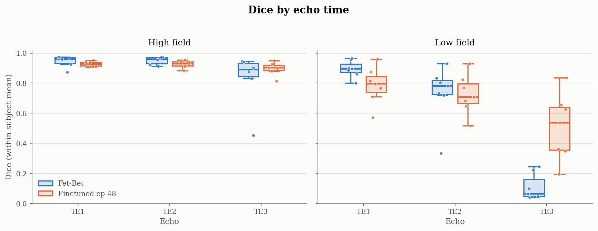
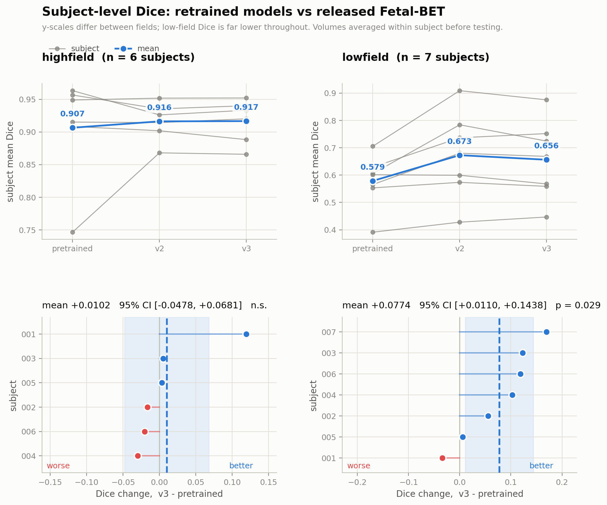

# Echo-Time-Robust Fetal Brain Extraction with Physics-Based Contrast Augmentation

Summer lab immersion, **CHUV Medical Image Analysis Laboratory (MIAL)**, July–August 2026
Mariem Maazoun, MSc Life Sciences Engineering, EPFL

This repository is a fork of [Fetal-BET](https://github.com/bchimagine/fetal-brain-extraction), a deep-learning tool for fetal brain extraction in MRI. It extends Fetal-BET to make brain extraction **robust to changes in echo time (TE) and field strength**, including low-field 0.55T acquisitions.

---

## Motivation

Fetal-BET was trained on standard T2-weighted scans. Its intensity augmentation is limited to noise, bias field and smoothing, so the model never learned to handle changes in **tissue contrast**. When the echo time changes (for example in multi-echo or low-field acquisitions), brain/background contrast shifts and segmentation quality drops sharply.

## Method

**1. Physics-based contrast augmentation.**
Tissue T2 values are estimated from multi-echo data, and real training images are **re-simulated at arbitrary echo times** using the MR signal model. The augmentation is applied to the physical signal, before intensity normalisation, so the model sees realistic contrast variations during training. *(The simulation module is developed in a separate repository.)*

**2. Fine-tuning.**
The pretrained Fetal-BET Attention U-Net is fine-tuned with this augmentation (PyTorch / MONAI). The training script was extended with:
- validation Dice tracked separately for each **field strength and echo**, rather than pooled,
- a stopping rule relative to the baseline checkpoint,
- an optional **hole-filling regulariser** with per-epoch diagnostics and gradient-ratio calibration of its weight,
- checkpointing and Weights & Biases logging.

**3. Extended evaluation (`src/codes/test.py`).**
- confusion-matrix metrics: sensitivity, specificity, precision and F1, both voxel-pooled and averaged per volume,
- **fragmentation scores**, which count disconnected components per slice to detect anatomically implausible masks,
- per-subject analysis with **paired t-tests and 95% confidence intervals**.

## Results

Mean Dice, released Fetal-BET vs. fine-tuned model (epoch 48):

| Test set | Stacks | Fetal-BET | Fine-tuned |
|---|---:|---:|---:|
| CHUV, simulated echo times | 1,296 | 0.785 | **0.881** |
| CHUV, original echo | 222 | 0.910 | 0.909 |
| Low-field 0.55T, multi-echo | 63 | 0.579 | **0.673** |
| High-field, multi-echo | 48 | – | 0.914 |

<p align="center">
  <br>
  <em>Dice by echo time. At low field and long TE (TE3), Fetal-BET almost fails completely, while the fine-tuned model recovers a large part of the segmentation.</em>
</p>

<p align="center">
  <br>
  <em>Subject-level paired comparison. At low field, Dice improves by +0.077 (95% CI [0.011, 0.144], p = 0.029, n = 7). At high field, the change is not significant.</em>
</p>

**Key findings**
- The largest gain is at **long echo times and low field**, exactly where the contrast shift is strongest.
- Performance on standard (original-echo) data is **preserved**.
- There is a trade-off: at short echo times on low-field data, the fine-tuned model is slightly below Fetal-BET, which motivates further work on balancing the augmentation.

The masks produced by this pipeline serve as input to a joint multi-echo slice-to-volume reconstruction.

---

## Repository structure

```
src/
├── codes/
│   ├── train.py                 # Fine-tuning with per-echo validation and hole regulariser
│   ├── test.py                  # Extended evaluation (confusion matrix, fragmentation)
│   ├── inference.py             # Brain extraction on new data
│   ├── data_generator_monai.py
│   └── model_zoo.py
├── configs/                     # Training and test configurations
├── figures/                     # Statistical analysis figures
└── results_mariem/
    ├── figures/                 # Result figures
    └── runs/                    # Per-volume metrics (CSV) and test logs
```

## Environment

```
Python 3.10

torch
torchvision
monai==1.2.0
numpy
scipy
pandas
nibabel
SimpleITK
scikit-image
scikit-learn
matplotlib
seaborn
tqdm
pyyaml
wandb
```

## Usage

**Fine-tuning**
```bash
cd src/codes
python train.py --cfg ../configs/train_configs.yml
```

**Evaluation**
```bash
python test.py --cfg ../configs/test_configs.yml
```

**Inference on new data**
```bash
python inference.py --data_path /path/to/data --save_path /path/to/predictions --saved_model_path /path/to/model.pth
```

Data paths in the configuration files must be adapted to your setup. Clinical data is not included in this repository.

---

## Acknowledgements

Based on **Fetal-BET** by Faghihpirayesh et al. (licensed under CC BY 4.0):

```bibtex
@article{faghihpirayesh2024fetal,
  title={Fetal-bet: Brain extraction tool for fetal mri},
  author={Faghihpirayesh, Razieh and Karimi, Davood and Erdo{\u{g}}mu{\c{s}}, Deniz and Gholipour, Ali},
  journal={IEEE Open Journal of Engineering in Medicine and Biology},
  year={2024},
  publisher={IEEE}
}
```

Work carried out at the Medical Image Analysis Laboratory (MIAL), CHUV, Lausanne.

*For research purposes only; not intended for clinical or diagnostic use.*
